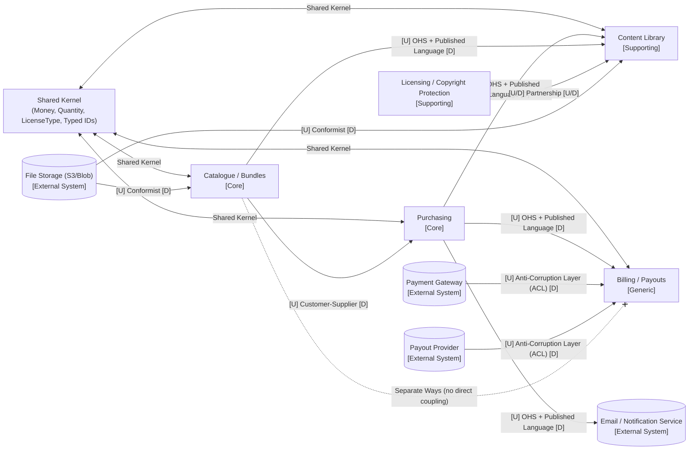
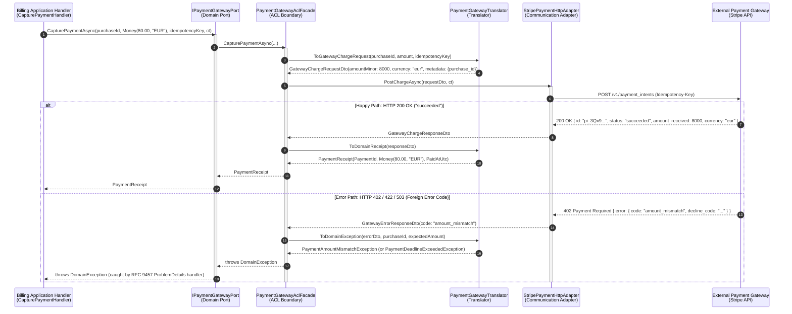

# Strategic Domain Design: Subdomain Classification, Context Map, and Anti-Corruption Layer

**Project:** BundleIt (implemented in solution `EShopService`, `.NET 10`) — a worldwide one-time-purchase platform for themed bundles of digital items (illustrations, brush sets, tutorials, music samples).
**Scope:** Task 1 (Stages 1–3) — Strategic DDD analysis aligned with the Event Storming board, Lab 2 tactical domain models (`stateDiagram-purchase.md` and `aggregates-and-invariants.md`), and the current codebase structure (`src/Services/<Context>/...`).

---

## Stage 1: Subdomain Classification and Bounded Context Canvas

### 1.1 Subdomain Classification Matrix

All five Bounded Contexts from the Event Storming board are classified below according to their strategic business impact, Lab 2 aggregates, and target internal microarchitecture (following Khononov's Subdomain–Microarchitecture matrix from Lecture 4).

> **Codebase & Naming Alignment:**
> - On the initial Event Storming board, the purchasing context was named **Subscriptions** (reflecting ongoing updates to active seasonal bundles). In Lab 2, this was refined to **Purchasing** (`Purchase`, `Cart`, `Buyer`) to reflect one-time purchases with permanent access.
> - In the current `EShopService` repository (`EShopService.sln`, `net10.0`), the `Billing` module (`src/Services/Billing/EShopService.Billing.Application`, `EShopService.Billing.Presentation`) already establishes the modular boundary for **Billing / Payouts**. The remaining contexts follow the same `src/Services/<Context>/` structure.

| Context | Classification | Main aggregates (from Lab 2) | Business justification | Module microarchitecture |
|---|---|---|---|---|
| **Purchasing** *(ES: Subscriptions)* | **Core** | `Purchase` *(pivotal)*, `Cart` (with `CartLine`), `Buyer` | BundleIt differentiates itself from commodity digital storefronts by combining one-time global bundle purchases with dual licensing (`Personal` vs. `Commercial`) and a usage-aware 14-day refund policy (`ViewCount == 0` for Personal; `DownloadCount == 0` for Commercial), which builds buyer trust while protecting creators against digital piracy. | **Rich Domain Model + Hexagonal / Clean Architecture** — Isolates the complex `Purchase` state machine, Strategy-based refund eligibility rules (`IRefundEligibilityPolicy`), and multi-currency cart invariants from HTTP controllers and EF Core persistence. |
| **Catalogue / Bundles** | **Core** | `Bundle` (with `BundleItem`), `Artist`, `Series` (via `SeriesId`) | Rather than selling isolated individual assets like traditional stock marketplaces, BundleIt creates a competitive market advantage through curated, growing themed collections ("playlists" and multi-part `Series`), co-op creator collaborations, and archival locks that keep previously purchased seasons permanently accessible. | **Rich Domain Model + Hexagonal / Clean Architecture** — Encapsulates `Bundle` publication lifecycle rules, archival constraints (`BundleArchivedException`), pricing invariants (`Commercial >= Personal`), and `ArtFile` validation inside pure domain objects. |
| **Licensing / Copyright Protection** | **Supporting** | `Report`, `LicensePolicy` *(domain policy / watermark specification)* | Creator retention depends on BundleIt' anti-AI-training commitment, automatic watermarking of licensed downloads, and copyright takedown workflows; these rules directly support our core creator value proposition without constituting a standalone commercial product. | **Rich Domain Model + Hexagonal / Clean Architecture** — Models license boundary enforcement (`Personal` view-only vs. `Commercial` download) and copyright infringement report workflows cleanly without infrastructure coupling. |
| **Content Library** | **Supporting** | `AccessRight`, `UsageRecord` (producing `UsageSummary`) | Guarantees permanent buyer access to purchased bundles (including newly added items in active bundles and archived seasons) while recording item opens and downloads required by the Core refund eligibility policy. | **Event Sourcing + CQRS** — Captures item view and download events as an immutable audit stream (`UsageRecord`) that feeds fast read projections (`Subscriber's library` and `UsageSummary`) via `.AsNoTracking()` queries. |
| **Billing / Payouts** *(Code: `EShopService.Billing`)* | **Generic** | `Payment` (with `Refund`), `Payout`, `Invoice` | Multi-currency payment capture, tax-compliant invoicing (`BillingDetails`, `TaxId`), and artist payout disbursements solve standard global marketplace financial problems that are commodity capabilities provided by external payment and banking rails. | **Transaction Script / Active Record** — Orchestrates straightforward ledger entries, invoice formatting, and external payment/payout gateway calls without complex domain state machines. |

---

### 1.2 Bounded Context Canvas: `Purchasing` (Core Subdomain)

| Canvas Section | Specification |
|---|---|
| **Name & Purpose** | **Purchasing** *(Event Storming: Subscriptions)* — Manages the buyer's pre-checkout shopping `Cart`, converts checked-out lines into independent per-bundle `Purchase` lifecycles, enforces payment deadlines and immutable `PriceSnapshot` values, and adjudicates license-specific refund requests. |
| **Strategic Classification** | **Core Subdomain** — Directly executes BundleIt' primary revenue-generating and trust-building differentiator (one-time bundle checkout with usage-verified refund protection). Implemented with **Rich Domain Model + Hexagonal / Clean Architecture** (`EShopService.Purchasing.Domain`, `.Application`, `.Infrastructure`, `.Presentation`). |
| **Ubiquitous Language Glossary** | **1. Purchase:** The pivotal aggregate representing one checked-out cart line (one `BuyerId`, one `BundleId`, one `LicenseType`, one `Quantity`) with an independent lifecycle (`Pending` $\rightarrow$ `Paid` $\rightarrow$ `AccessGranted` $\rightarrow$ `Completed` or `Refunded` / `Cancelled`).<br>**2. Cart:** A buyer's temporary pre-checkout basket holding `CartLine` entities up to a maximum total of 25 items in a single currency.<br>**3. LicenseType:** Closed domain enum distinguishing `Personal` (view-only inside the app, quantity strictly 1) from `Commercial` (view plus original file download, requires `BillingDetails`).<br>**4. PriceSnapshot:** Immutable `Money` value captured at `StartPurchase` (`unitPrice * quantity`) so future bundle price changes never affect an in-flight or completed purchase.<br>**5. PaymentDeadline:** UTC time window (`StartsAt`, `ExpiresAt`, default 1 hour, allowed 15 min–24 h) within which `ConfirmPayment` must arrive before automatic cancellation.<br>**6. RefundWindow:** 14-day period following `AccessGrantedAt` during which a buyer may submit at most one `RequestRefund` command.<br>**7. UsageSummary:** Immutable value object (`ViewCount`, `DownloadCount`, `WasOpened`, `WasDownloaded`) supplied from `Content Library` to evaluate refund eligibility. |
| **Business Rules & Invariants (from Lab 2)** | - **Rule 1 (`PaymentAmountMismatchException`):** `ConfirmPayment` succeeds only if `paid == PriceSnapshot` (exact amount and ISO 4217 currency).<br>- **Rule 2 (`PaymentDeadlineExceededException`):** `ConfirmPayment` is rejected if `now > Deadline.ExpiresAt`.<br>- **Rule 3 (`PurchaseNotPayableException`):** Only a `Pending` purchase can accept payment (never `Cancelled`, `Paid`, or `Refunded`).<br>- **Rule 4 (`BusinessBuyerTaxIdRequiredException`):** A `Commercial` purchase requires valid `BillingDetails` whose `CountryCode` matches `TaxId.CountryCode`.<br>- **Rule 5 (`PaidPurchaseCancellationException`):** An `AccessGranted` purchase cannot be cancelled directly; it can only exit via the refund workflow.<br>- **Rule 6 (`RefundWindowClosedException` / `RefundAlreadyRequestedException`):** Refunds can be requested only within 14 days of `AccessGrantedAt` and with no open refund request.<br>- **Rule 7 (`RefundNotEligibleException`):** `PersonalRefundPolicy` approves only if `!usage.WasOpened` (`ViewCount == 0`); `CommercialRefundPolicy` approves only if `!usage.WasDownloaded` (`DownloadCount == 0`).<br>- **Rules 13–16 (`Cart` invariants):** Max 25 total items per cart (`CartLimitExceededException`), `Personal` line quantity fixed at 1 (`InvalidQuantityException`), single currency per cart (`CartCurrencyMismatchException`), and no edits after checkout (`CartAlreadyCheckedOutException`). |
| **Incoming Commands & Queries** | **Commands:** `AddCartLineCommand`, `CheckoutCartCommand`, `StartPurchaseCommand`, `RegisterFailedPaymentCommand`, `ConfirmPaymentCommand`, `CancelUnpaidPurchaseCommand`, `GrantAccessCommand`, `RequestRefundCommand`, `ApproveRefundCommand`, `RejectRefundCommand`, `CloseRefundWindowCommand`.<br>**Queries (CQRS Read Path):** `GetCartSummaryQuery`, `GetPurchaseDetailsQuery`, `GetBuyerPurchaseHistoryQuery`. |
| **Outgoing Domain Events** | `CartCheckedOut`, `PurchaseStarted`, `PaymentAttemptFailed`, `PurchasePaid`, `PurchaseCancelled`, `AccessGranted`, `RefundRequested`, `RefundApproved`, `RefundRejected`, `RefundWindowClosed`. |
| **Dependencies** | **Upstream Contexts:** `Catalogue / Bundles` (verifies bundle publication status, offered `LicenseType` options, and current unit `Money` price at checkout), `Content Library` (provides `UsageSummary` read projection during refund evaluation).<br>**Downstream Consumers:** `Content Library` (grants/revokes `AccessRight` on `PurchasePaid` / `RefundApproved`), `Billing / Payouts` (captures payment, processes refund disbursement, issues commercial `Invoice`), `Email / Notification Service` (sends receipts and refund decisions).<br>**Shared Kernel:** `BundleIt.SharedKernel` (`Money`, `Quantity`, `LicenseType`, strongly typed IDs). |

---

## Stage 2: Context Map Diagram and Relationship Rationale

### 2.1 System Context Map (Mermaid Flowchart)

The diagram below depicts all five Bounded Contexts, the `Shared Kernel`, and the four external systems from the Event Storming board. Every edge specifies the dependency direction (`Upstream [U]` $\rightarrow$ `Downstream [D]`) and one of **six distinct DDD integration patterns**.



### 2.2 Shared Kernel Explicit Boundary Specification

To prevent the `Shared Kernel` from degenerating into a coupled monolith (Lecture 4, Slide 8), its assembly (`BundleIt.SharedKernel`) is strictly governed by architectural fitness tests and may contain **only** small, immutable, dependency-free primitives:

- **Value Objects:** `Money` (with `CurrencyCatalog`), `Quantity`, `UsageSummary`.
- **Closed Domain Enums:** `LicenseType` (`Personal = 1`, `Commercial = 2`).
- **Strongly Typed Identifiers (`readonly record struct`):** `ArtistId`, `BuyerId`, `BundleId`, `BundleItemId`, `SeriesId`, `PurchaseId`, `PaymentId`, `RefundId`, `AccessRightId`, `PayoutId`, `InvoiceId`.
- **Explicitly Excluded:** No entities or aggregates (`Purchase`, `Bundle`, `Cart`, `Payment`, `AccessRight`), no EF Core `DbContext` mappings, and no external SDK DTOs.

### 2.3 Relationship Rationale Table

| Upstream `[U]` $\rightarrow$ Downstream `[D]` | Pattern | Who dictates the model? | Why this pattern was chosen | Main architectural risk |
|---|---|---|---|---|
| `Shared Kernel` $\leftrightarrow$ `Purchasing`, `Catalogue`, `Billing`, `Content Library` | **Shared Kernel** | Jointly agreed core domain team | Eliminates primitive obsession (`decimal`, `Guid`) across module contracts so `Money` currency safety and strongly typed IDs are enforced at compile time everywhere. | Accidental bloat if developers add mutable entities or service-specific DTOs, creating release coupling. |
| `Catalogue / Bundles [U]` $\rightarrow$ `Purchasing [D]` | **Customer–Supplier** | Upstream (`Catalogue`), prioritizing Downstream (`Purchasing`) checkout needs | `Purchasing` needs reliable read contracts for bundle publication status, `Personal`/`Commercial` pricing, and `Series` metadata during checkout, while `Catalogue` owns bundle authoring. | Upstream roadmap delays could bottleneck new checkout features if contract changes are not coordinated. |
| `Purchasing [U]` $\rightarrow$ `Content Library [D]` | **Open Host Service (OHS) + Published Language** | Upstream (`Purchasing`) via versioned AsyncAPI/OpenAPI events | `Purchasing` publishes stable, canonical domain events (`PurchasePaid`, `RefundApproved`) that trigger asynchronous `AccessRight` provisioning and revocation without coupling `Purchasing` to storage mechanics. | High discipline required to maintain backward compatibility and schema versioning (`v1` $\rightarrow$ `v2`) for published events. |
| `Purchasing [U]` $\rightarrow$ `Billing / Payouts [D]` | **Open Host Service (OHS) + Published Language** | Upstream (`Purchasing`) via versioned REST/event contracts | Decouples core checkout and refund state transitions from generic payment capture, refund disbursement, and `Invoice` generation. | Contract versioning overhead and eventual consistency handling if downstream `Billing` processing lags. |
| `Catalogue / Bundles [U]` $\rightarrow$ `Content Library [D]` | **Open Host Service (OHS) + Published Language** | Upstream (`Catalogue`) via published events (`BundleItemAdded`, `BundleArchived`) | Enables the automatic policy *"unlock new items for existing members"* when an artist adds items to an active bundle without direct database sharing. | Event ordering and idempotency must be guaranteed when multiple items are added rapidly to a bundle. |
| `Licensing / Copyright Protection` $\leftrightarrow$ `Content Library` | **Partnership** | Both contexts jointly | Watermark injection on licensed downloads (`Automatic watermark on every licensed download`) and immediate file access suspension upon valid copyright `Report` require tightly coordinated workflows and shared security invariants. | Coordination overhead and synchronized deployment planning when watermark or takedown rules evolve. |
| `Payment Gateway [U]` $\rightarrow$ `Billing / Payouts [D]` | **Anti-Corruption Layer (ACL)** | External provider (`Payment Gateway`) dictates wire protocol; `Billing` translates at boundary | Protects our domain from provider-specific minor-unit integers, snake_case status strings, and raw gateway error codes by translating them into `Money`, `PaymentId`, and domain exceptions. | Ongoing maintenance cost of the translator and adapter whenever the external gateway upgrades its API version. |
| `Payout Provider [U]` $\rightarrow$ `Billing / Payouts [D]` | **Anti-Corruption Layer (ACL)** | External provider (`Payout Provider`) dictates wire protocol; `Billing` translates at boundary | Isolates artist disbursement (`Payout`) from external banking/transfer schemas, IBAN/routing formats, and settlement failure codes. | Translation layer maintenance and thorough contract/chaos testing needed for payout failure edge cases. |
| `File Storage [U]` $\rightarrow$ `Content Library [D]` & `Catalogue [D]` | **Conformist** | External cloud storage provider (e.g., S3 / Azure Blob SDK) | Object storage primitives (buckets, signed URLs, byte streams) are a well-standardized technical commodity; building a custom domain language around blob upload mechanics adds zero business value. | Direct dependency on the cloud storage SDK's signed-URL and stream abstractions inside infrastructure adapters. |
| `Purchasing [U]` $\rightarrow$ `Email / Notification Service [D]` | **Open Host Service (OHS) + Published Language** | Upstream (`Purchasing`) via published events | Transactional emails (purchase confirmation, payment deadline reminder, refund status) react purely to published domain events without needing custom translations. | Delivery failures in the external email provider must be isolated so they never roll back core purchase transactions. |
| `Catalogue / Bundles` $\leftrightarrow$ `Billing / Payouts` | **Separate Ways** | No shared model (independent) | Artist earnings projections are built asynchronously from `PurchasePaid` and `Payout` events; direct integration between `Catalogue` authoring and `Billing` ledgers is unnecessary and would create harmful coupling. | Slight eventual consistency delay in displaying updated artist earnings on the artist dashboard. |

---

## Stage 3: Anti-Corruption Layer (ACL) Specification

### 3.1 Selected Integration & Architectural Rationale

We place an **Anti-Corruption Layer (ACL)** on the boundary between the external **`Payment Gateway` [U]** and our **`Billing / Payouts` [D]** context (which in turn serves `Purchasing` via `IPaymentGatewayPort`).

External payment processors (such as Stripe or Adyen) expose an **alien model**:
- Monetary amounts are transmitted as `long` integers in minor currency units (e.g., `8000` instead of `80.00 EUR`, or `8000` for `8000 JPY` where minor unit exponent is `0`), paired with lowercase currency codes (`"eur"`).
- Transaction outcomes and decline reasons use provider-specific strings (`"requires_payment_method"`, `"intent_expired"`, `"amount_received_mismatch"`).
- Allowing these primitives into our domain would violate **Invariant #1 (`PaymentAmountMismatchException`)**, **Invariant #2 (`PaymentDeadlineExceededException`)**, and corrupt our `Money` Value Object rules.

### 3.2 ACL Flow Diagram (Happy Path and Error Path)



### 3.3 Domain Port C# Interface Signature

Defined inside `EShopService.Billing.Domain` (or `BundleIt.Billing.Domain.Ports`), expressed strictly in our Ubiquitous Language using Lab 2 Value Objects and strongly typed identifiers—with zero references to HTTP clients or external SDK DTOs:

```csharp
namespace EShopService.Billing.Domain.Ports;

using BundleIt.SharedKernel.Identifiers;
using BundleIt.SharedKernel.ValueObjects;

public sealed record PaymentReceipt(
    PaymentId PaymentId,
    PurchaseId PurchaseId,
    Money CapturedAmount,
    DateTimeOffset ProcessedAtUtc);

public sealed record RefundReceipt(
    RefundId RefundId,
    PaymentId OriginalPaymentId,
    Money RefundedAmount,
    DateTimeOffset RefundedAtUtc);

/// <summary>
/// Outbound Domain Port protecting Billing and Purchasing from external payment gateway models.
/// </summary>
public interface IPaymentGatewayPort
{
    Task<PaymentReceipt> CapturePaymentAsync(
        PurchaseId purchaseId,
        Money expectedAmount,
        Guid idempotencyKey,
        CancellationToken cancellationToken = default);

    Task<RefundReceipt> IssueRefundAsync(
        PaymentId paymentId,
        PurchaseId purchaseId,
        Money refundAmount,
        Guid idempotencyKey,
        CancellationToken cancellationToken = default);

    Task<PaymentReceipt?> FindPaymentByPurchaseAsync(
        PurchaseId purchaseId,
        CancellationToken cancellationToken = default);
}
```

### 3.4 Foreign-to-Domain Translation Mapping Table

| External Gateway Element (Alien Model) | Direction | BundleIt Domain Equivalent (Lab 2 Model) | Translation & Validation Rule inside `PaymentGatewayTranslator` |
|---|---|---|---|
| `amount_received` (`long`, e.g., `8000`) + `currency` (`string`, e.g., `"eur"`) | Inbound $\rightarrow$ Domain | **`Money` (Value Object)** (`Money.Of(80.00m, "EUR")`) | Queries `CurrencyCatalog.TryGetMinorUnits(currency.ToUpperInvariant(), out var digits)`, divides `amount_received` by $10^{\text{digits}}$ (so `8000` `"eur"` $\rightarrow$ `80.00 EUR`, whereas `8000` `"jpy"` $\rightarrow$ `8000 JPY`), and constructs `Money.Of(...)` which enforces non-negative bounds and ISO 4217 catalog membership. |
| `metadata["purchase_id"]` (`string` UUID) & `id` (`string`, e.g., `"pi_3Qx9..."`) | Bidirectional | **`PurchaseId`** & **`PaymentId`** (Strongly Typed IDs) | Validates UUID format for `PurchaseId` and maps the external opaque gateway reference to a deterministic/stored `PaymentId`, preventing primitive `string`/`Guid` swaps. |
| `error.code = "amount_received_mismatch"` (or captured minor units $\neq$ expected) | Inbound Error $\rightarrow$ Domain Exception | **`PaymentAmountMismatchException`** *(Invariant #1)* | Prevents partial or over-captured gateway charges from entering the domain; raises our domain exception carrying expected vs. actual `Money`. |
| `error.code = "payment_intent_expired"` / `"charge_expired"` | Inbound Error $\rightarrow$ Domain Exception | **`PaymentDeadlineExceededException`** *(Invariant #2)* | Translates provider timeout/expiry codes into our `PaymentDeadline` domain vocabulary so `Purchasing` can transition the `Purchase` to `Cancelled`. |
| `error.code = "card_declined"` / `"insufficient_funds"` | Inbound Error $\rightarrow$ Domain Exception | **`PaymentDeclinedByProviderException`** *(Transition T2)* | Maps diverse bank/card decline codes into a single domain failure event (`PaymentAttemptFailed`) so `Purchase` tracks the 3-attempt retry limit cleanly. |
| HTTP `502` / `503` / `504` or socket timeout | Inbound Error $\rightarrow$ Infrastructure/Domain Fault | **`PaymentGatewayUnavailableException`** | Caught after Polly retries exhaust; mapped by global `IExceptionHandler` to RFC 9457 `503 Service Unavailable` with `Retry-After` and W3C `traceparent`. |