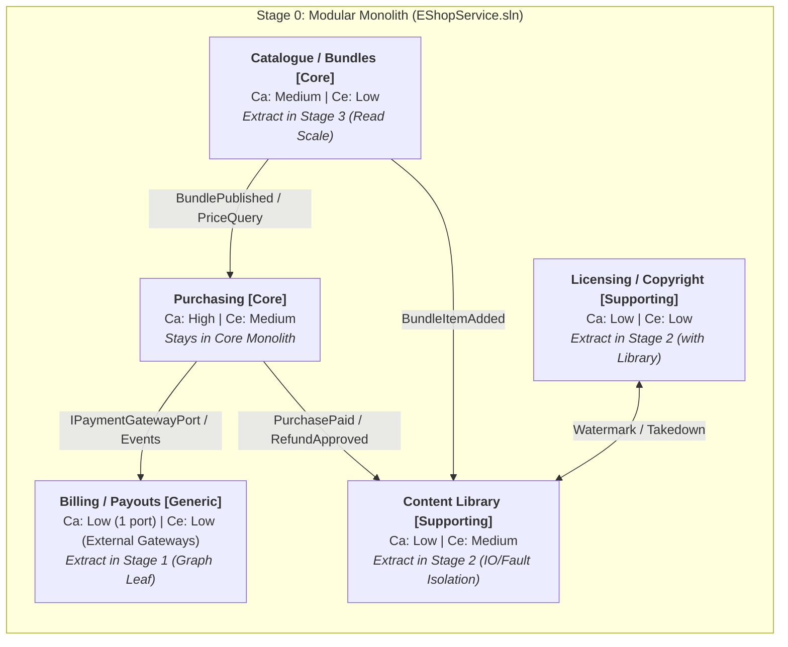
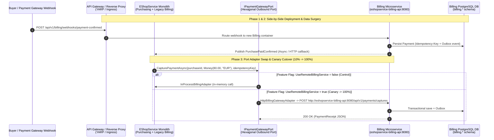

# Decomposition Roadmap & Strangler Fig Plan (Task 2: Stages 4–5)

**Project:** BundleIt (`EShopService.sln`, `.NET 10`)
**Scope:** Task 2 (Stages 4–5) — Force analysis (Disintegrators vs. Integrators), incremental extraction roadmap from the edges of the dependency graph, data surgery plan, and Strangler Fig execution plan for Roadmap Stage 1 (`Billing / Payouts`).
**Theoretical & Architectural Basis:** Richards & Ford (*Software Architecture: The Hard Parts*, Lecture 4 Slide 10) and Sam Newman (*Monolith to Microservices*, Lecture 4 Slides 11 & 16–18).

---

## Stage 4: Force Analysis and Decomposition Roadmap

### 4.1 Architectural Force Analysis: Disintegrators vs. Integrators

Before splitting the `EShopService` modular monolith into separately deployed services, we evaluate the competing architectural forces across all five Bounded Contexts identified in `docs/architecture/context-map.md`.

#### Disintegrators (Forces Pushing Toward Extraction)

| Force (Richards & Ford) | Application to BundleIt (`EShopService`) | Affected Contexts |
|---|---|---|
| **1. Fault Isolation** | External payment gateways, banking payout providers, and heavy media watermarking / ZIP packaging can experience 15–45 s latency spikes or memory pressure. Isolating them prevents thread-pool exhaustion from taking down core checkout or bundle browsing. | `Billing / Payouts`, `Content Library`, `Licensing / Copyright Protection` |
| **2. Security & Compliance Boundary** | `Billing / Payouts` handles external payment gateway webhooks, artist payout bank/IBAN credentials, and commercial buyers' `TaxId` / `BillingDetails`. Extracting it narrows the compliance and secret-management audit surface to one small service. | `Billing / Payouts` |
| **3. Scaling Asymmetry** | Public bundle discovery (`Catalogue / Bundles`: artist pages, bundle previews, search) experiences $100\times$–$1000\times$ higher read traffic than transactional checkout writes (`Purchasing`), especially during seasonal launches (e.g., *Inktober 2026*). | `Catalogue / Bundles` (read-heavy) vs. `Purchasing` (write-heavy) |
| **4. Different Release Pace** | `Purchasing` promotional rules, cart limits, and refund policies evolve frequently with product experiments, whereas `Billing / Payouts` tax/invoicing rules and `Content Library` storage streaming change on a slower, compliance-driven cadence. | `Purchasing` vs. `Billing / Payouts` |
| **5. Technology & Resource Polyglotism** | `Licensing / Copyright Protection` and `Content Library` perform CPU/IO-intensive image/audio watermarking and multi-gigabyte `ArtFile` streaming (up to 2 GB per file), benefiting from dedicated worker memory/CPU limits separate from low-latency REST APIs. | `Content Library`, `Licensing / Copyright Protection` |

#### Integrators (Forces Keeping Contexts Together Initially)

| Force (Richards & Ford) | Application to BundleIt (`EShopService`) | Architectural Consequence |
|---|---|---|
| **1. Shared ACID Consistency Boundary** | Checking out a `Cart` (up to 25 lines) creates one `Purchase` per line with an atomic `PriceSnapshot` and `PaymentDeadline`. Splitting `Cart` from `Purchase` across network boundaries would introduce distributed two-phase commits. | `Cart`, `Purchase`, and `Buyer` remain together inside the `Purchasing` Core context. |
| **2. Tightly Coupled Workflow (Partnership)** | Automatic watermarking on licensed download (`Content Library` + `Licensing`) and immediate takedown of reported copyright-infringing items require synchronous coordination. | Keep `Licensing / Copyright Protection` closely aligned with `Content Library` until event contracts stabilize. |
| **3. Small Engineering Team & Evolving Boundaries** | Operating 5 distributed services, 5 databases, and distributed tracing on day one imposes heavy operational overhead while domain boundaries are still being validated. | Start as a **Modular Monolith** (Stage 0) with strict assembly boundaries (`FF-01`..`FF-05`) and extract incrementally from the graph edges. |

---

### 4.2 Dependency Graph & Incremental Decomposition Roadmap

Following Sam Newman's strategy (*"extract from the edges/leaves of the dependency graph inward, keeping the Core domain in the monolith longest"*), we rank modules by their afferent coupling ($C_a$, incoming dependencies), efferent coupling ($C_e$, outgoing dependencies), subdomain classification, and primary Non-Functional Requirement (NFR) drivers.

#### Decomposition Roadmap Summary Table

| Module | Subdomain Type | Coupling in Graph ($C_a / C_e$) | Main NFR & Architectural Reason | Extraction Order |
|---|---|---|---|---|
| **Billing / Payouts** (`EShopService.Billing`) | **Generic** | **Low $C_a$** (called only by `Purchasing` via `IPaymentGatewayPort` & events), **Low $C_e$** (talks only to external Payment/Payout APIs) | **Security boundary & Fault isolation:** Isolates PCI/payment secrets, external gateway latency spikes, and webhook retries from core checkout; already structured as `src/Services/Billing` in `EShopService.sln`. | **Stage 1** *(First extraction — graph leaf)* |
| **Content Library** & **Licensing / Copyright Protection** | **Supporting** | **Low $C_a$**, **Medium $C_e$** (consumes `PurchasePaid`, `RefundApproved`, `BundleItemAdded`; talks to `File Storage`) | **Fault & resource isolation:** Heavy `ArtFile` downloads (up to 2 GB), watermark processing, and Event Sourced `UsageRecord` writes are isolated from checkout CPU/memory pools. | **Stage 2** *(Event-driven consumers)* |
| **Catalogue / Bundles** | **Core** | **Medium $C_a$** (queried by `Purchasing` & public storefront), **Low $C_e$** | **Asymmetric read scaling:** Browsing seasonal bundles, artist portfolios, and previews generates $100\times$ more traffic than writes, justifying independent horizontal scaling and aggressive read caching. | **Stage 3** *(Read-heavy Core)* |
| **Purchasing** (`Purchase`, `Cart`, `Buyer`) | **Core** | **High $C_a$ / High $C_e$** (center of the dependency graph; orchestrates checkout and refund state machine) | **Transactional integrity & stability:** Holds the pivotal `Purchase` state machine and `Cart` invariants; remains in the monolith core until all surrounding contracts are battle-tested. | **Stays in Core** *(Stage 0 $\rightarrow$ End)* |

---

### 4.3 Pre-Extraction Data Surgery (Database-per-Service Preparation)

Before any network cut occurs in Stage 1, we execute **Data Surgery** inside the monolith (Lecture 4, Slides 16–17) to eliminate shared database coupling:

1. **Schema Separation:** Split shared database tables into isolated schemas (`purchasing.Purchases`, `purchasing.Carts` vs. `billing.Payments`, `billing.Refunds`, `billing.Payouts`, `billing.Invoices`), each managed by its own EF Core `DbContext` (`PurchasingDbContext`, `BillingDbContext`) and independent `__EFMigrationsHistory`.
2. **Foreign Key Removal:** Drop all database-level `FOREIGN KEY` constraints crossing between `billing.*` and `purchasing.*`. `billing.Payments` stores only the strongly typed `PurchaseId` value and an immutable `PriceSnapshot` (`Money`), honoring Vernon's 3rd aggregate rule.
3. **Database Least-Privilege Enforcement (Fitness Function `FF-05`):** Provision separate database users (`purchasing_user` and `billing_user`) where `billing_user` has zero `SELECT`/`UPDATE` permissions on `purchasing.*` tables, verified automatically in CI via `sys.foreign_keys` / `information_schema` checks.

---

## Stage 5: Strangler Fig Plan for Roadmap Stage 1 (`Billing / Payouts`)

To extract **`Billing / Payouts`** (`EShopService.Billing`) into an independent containerized microservice (`eshopservice-billing-api` in `docker-compose.yml`) with **zero downtime** and **zero changes to `Purchasing.Domain` or `Purchasing.Application`**, we apply Sam Newman's **Strangler Fig** pattern in four controlled phases.

### Step-by-Step Strangler Fig Execution Plan

1. **Step 1 — Establish the Hexagonal Seam & Contract (`Expand`):**
   - Formalize the OpenAPI 3.1 contract (`docs/contracts/openapi-billing.yaml`) for `POST /api/v1/payments/captures`, `POST /api/v1/payments/{id}/refunds`, and `POST /api/v1/payouts`, requiring the `Idempotency-Key` header and RFC 9457 `application/problem+json` error responses.
   - Ensure all calls from `Purchasing.Application` go exclusively through `IPaymentGatewayPort` (no direct references to `EShopService.Billing.Infrastructure` or `BillingDbContext`, enforced by Fitness Function `FF-01`/`FF-05`).
2. **Step 2 — Stand Up the New Service Container & Isolate Data (`Data Surgery`):**
   - Deploy `EShopService.Billing.Presentation` as a standalone container (`eshopservice-billing-api`) in `docker-compose.yml` connected to its own dedicated `billing` database/schema.
   - Backfill historical `Payments`, `Refunds`, `Payouts`, and `Invoices` records into the isolated `billing` database and verify row counts and checksums.
3. **Step 3 — Edge Routing & Adapter Cutover (`Migrate`):**
   - **External Webhooks:** Reconfigure the API Gateway / reverse proxy to route incoming Payment Gateway and Payout Provider webhooks (`/api/v1/billing/webhooks/*`) directly to `eshopservice-billing-api`.
   - **Internal Calls:** Implement `HttpBillingGatewayAdapter : IPaymentGatewayPort` inside `Purchasing.Infrastructure` using `IHttpClientFactory`, Polly v8 resilience policies, W3C `traceparent` propagation, and a Tolerant Reader DTO.
   - Roll out via a feature toggle (`Billing:UseRemoteService`) using canary increments (**10% $\rightarrow$ 50% $\rightarrow$ 100%** of checkout traffic), comparing latency ($p_{95}$), error rates, and ledger reconciliation against expected SLOs.
4. **Step 4 — Retiring Legacy Monolith Code (`Contract`):**
   - Once 100% of traffic has run cleanly on `eshopservice-billing-api` for 7 days with zero reconciliation discrepancies, remove `InProcessBillingAdapter` and the legacy billing assemblies from the monolith's deployment artifact.