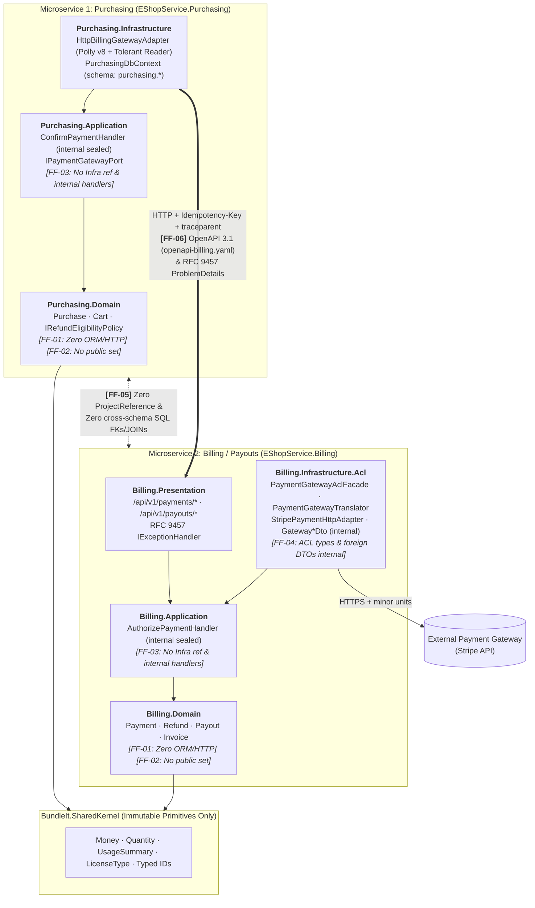

# Architectural Fitness Functions and Microservice Boundary Guardrails

**Project:** BundleIt (`EShopService.sln`, `.NET 10`) — a worldwide one-time-purchase platform for themed bundles of digital items.
**Scope:** Lab 4 (Task 1, Stages 1–2) — Static architectural Fitness Functions (`FF-01`..`FF-05`), dynamic contract and reliability Fitness Functions (`FF-06`..`FF-07`), boundary placement diagram, API versioning/backward-compatibility policy, and machine-readable rules for `AGENTS.md` and `CleanArchitectureGuardTests`.
**Related Artifacts:**
- [`aggregates-and-invariants.md`](./aggregates-and-invariants.md) (Lab 2 Value Objects, strongly typed IDs, and Invariants #1–#17)
- [`stateDiagram-purchase.md`](./stateDiagram-purchase.md) (Lab 2 `Purchase` state machine `T1`–`T9` and `IRefundEligibilityPolicy`)
- [`context-map.md`](./context-map.md) (Lab 3 Bounded Contexts, Context Map patterns, and Payment Gateway ACL)
- [`openapi-billing.yaml`](../contracts/openapi-billing.yaml) (Lab 4 Contract-First OpenAPI 3.1 contract for `Billing / Payouts`)

---

## Stage 1: Static Guards for Layer Purity and the Domain Model Inside a Microservice

The table below defines the internal architectural Fitness Functions enforced across our `.NET 10` Bounded Context assemblies (`EShopService.Purchasing.*`, `EShopService.Bundles.*`, `EShopService.Billing.*`, `EShopService.Licensing.*`, and `EShopService.ContentLibrary.*`).

| ID | Guard name | Scope (Layer / Namespace) | Verifiable rule (Technical predicate) | What AI / developer mistake does it stop? | Verification tool |
|---|---|---|---|---|---|
| **FF-01** | **Technology purity of the Domain layer** | `EShopService.*.Domain` and `BundleIt.SharedKernel` (`EShopService.Purchasing.Domain`, `EShopService.Bundles.Domain`, `EShopService.Billing.Domain`, `EShopService.Licensing.Domain`, `EShopService.ContentLibrary.Domain`) | Assembly dependency graph must contain **0** references to `*.Application`, `*.Infrastructure`, `*.Presentation`, `Microsoft.EntityFrameworkCore.*`, `Microsoft.AspNetCore.*`, `System.Text.Json`, `Npgsql`, `System.Net.Http`, or message broker SDKs (MassTransit / RabbitMQ / Kafka). Types and members must have **0** ORM/serialization attributes (`[Table]`, `[Key]`, `[Column]`, `[ForeignKey]`, `[JsonPropertyName]`). | Stops an LLM or developer from leaking EF Core attributes, SQL types, or HTTP/JSON dependencies into pure domain models (`Purchase`, `Bundle`, `Money`, `TaxId`). | `dotnet test` (`CleanArchitectureGuardTests.FF01` via `NetArchTest.Rules` / `System.Reflection`) |
| **FF-02** | **Encapsulation of invariants in aggregates and Value Objects** | All Aggregate Roots, Entities, and Value Objects in `EShopService.*.Domain` (`Purchase`, `Cart`, `CartLine`, `Bundle`, `BundleItem`, `AccessRight`, `UsageRecord`, `Payment`, `Payout`, `Invoice`; Value Objects `Money`, `Quantity`, `TaxId`, `BillingDetails`, `PaymentDeadline`, `UsageSummary`, `SeriesPart`, `ArtFile`) | Every non-exception, non-event domain class/record in `*.Domain` must have **0** public property setters (`PropertyInfo.GetSetMethod(nonPublic: false) == null`) and **0** public parameterless constructors (`GetConstructor(Type.EmptyTypes) == null`). Value Objects (`Money`, `Quantity`, `TaxId`, `BillingDetails`, `PaymentDeadline`, `UsageSummary`, `SeriesPart`, `ArtFile`) must additionally be declared `sealed`. State changes occur exclusively through Ubiquitous Language methods and static Factory Methods (`Purchase.Start`, `Cart.CreateEmpty`). | Prevents anemic CRUD entities with open `public set` properties that would allow bypassing Lab 2 Invariants **#1–#3** (`PriceSnapshot` & `PaymentDeadline`), **#4** (`Commercial` `BillingDetails`/`TaxId`), **#6–#7** (14-day refund window & `PersonalRefundPolicy`/`CommercialRefundPolicy`), **#8–#9** (`AccessRight` download & revocation rules), **#10–#12** (`Bundle` archival & pricing), **#13–#16** (`Cart` 25-item & single-currency limits), and **#17** (`Payout` balance limit). | `dotnet test` (`CleanArchitectureGuardTests.FF02` via `System.Reflection`) |
| **FF-03** | **Isolation of the Application layer and CQRS encapsulation** | `EShopService.*.Application` (`EShopService.Purchasing.Application`, `EShopService.Bundles.Application`, `EShopService.Billing.Application`, `EShopService.Licensing.Application`, `EShopService.ContentLibrary.Application`) | `*.Application` assemblies must have **0** dependencies on `*.Infrastructure`, `*.Presentation`, `Microsoft.EntityFrameworkCore.*`, or `Microsoft.AspNetCore.*`. Furthermore, all concrete classes whose names end with `CommandHandler` or `QueryHandler` (e.g., `ConfirmPaymentCommandHandler`, `RequestRefundCommandHandler`, `GetPaymentByIdQueryHandler`) must be `internal sealed` (`!IsPublic && IsSealed`). | Prevents controllers from bypassing Application Ports/Mediators to call internal handlers directly, stops EF Core `DbContext` queries from leaking into business use cases, and preserves single-entry module facades. | `dotnet test` (`CleanArchitectureGuardTests.FF03` via `NetArchTest.Rules` / `System.Reflection`) |
| **FF-04** | **Tightness of the Anti-Corruption Layer (ACL) boundary** | `EShopService.Billing.Infrastructure.Acl` (and any `*.Infrastructure.Acl` namespace) vs. `EShopService.Billing.Application` / `EShopService.Billing.Domain` | All external integration DTOs (`GatewayChargeRequestDto`, `GatewayChargeResponseDto`, `GatewayErrorResponseDto`), translators (`PaymentGatewayTranslator`), HTTP adapters (`StripePaymentHttpAdapter`), and ACL facades (`PaymentGatewayAclFacade`) in `*.Infrastructure.Acl` must have `internal` visibility (`!IsPublic`). Public port interfaces (`IPaymentGatewayPort`) in `*.Application` / `*.Domain` must reference **0** types from `*.Infrastructure.*` or external gateway namespaces. | Stops foreign payment gateway concepts (minor-unit `long` amounts, lowercase `"eur"` strings, `"payment_intent_expired"` / `"amount_received_mismatch"` codes) from leaking into `Billing` or `Purchasing` and corrupting `Money`, `PaymentId`, or `PurchaseId`. | `dotnet test` (`CleanArchitectureGuardTests.FF04` via `NetArchTest.Rules` / `System.Reflection`) |

---

## Stage 2: Guards for Autonomy Between Microservices and Dynamic Functions (`FF-05`..`FF-07`)

### 2.1 Cross-Microservice Static Isolation Guard (`FF-05`)

| ID | Guard name | Scope (Layer / Namespace) | Verifiable rule (Technical predicate) | What AI / developer mistake does it stop? | Verification tool |
|---|---|---|---|---|---|
| **FF-05** | **Isolation between microservices in code and in the database (`Database-per-Service`)** | All Bounded Context projects under `src/Services/*` (`Bundles`, `Billing`, `Licensing`, `Purchasing`, `ContentLibrary`) and all EF Core `Migrations/*.cs` + PostgreSQL schemas (`purchasing.*`, `billing.*`, `bundles.*`, `licensing.*`, `library.*`) | **1. Code isolation:** No assembly in `EShopService.<ContextA>.*` may have a `<ProjectReference>` or `using` dependency on any assembly in `EShopService.<ContextB>.*` (`ContextA != ContextB`); only `BundleIt.SharedKernel` may be referenced across contexts. **2. Database isolation:** Each service owns its own `DbContext` and `__EFMigrationsHistory`. EF Core migrations and database catalogs must contain **0** `FOREIGN KEY` constraints referencing another service's schema (`principalSchema != ownSchema`), **0** cross-schema SQL `JOIN`s, and separate DB roles (`billing_user` has `0` `SELECT`/`UPDATE` privileges on `purchasing.*`). | Prevents the **Distributed Monolith** anti-pattern where two microservices become release-coupled through shared C# assemblies, shared SQL tables, foreign keys, or cross-schema `JOIN`s. | `dotnet test` (`CleanArchitectureGuardTests.FF05`) + CI SQL schema audit (`information_schema.table_constraints`) |

---

### 2.2 Dynamic Contract and Runtime Reliability Fitness Functions (`FF-06`..`FF-07`)

| ID | Guard name | Scope (Endpoint / Service Flow) | Measurable SLO & Verifiable Rule | What failure / regression does it stop? | Verification tool |
|---|---|---|---|---|---|
| **FF-06** | **OpenAPI 3.1 Contract Compliance & ProblemDetails Validation** | All HTTP endpoints exposed by `EShopService.Billing.Presentation` (`POST /api/v1/payments/authorizations`, `GET /api/v1/payments/{paymentId}`, `POST /api/v1/payments/{paymentId}/refunds`, `POST /api/v1/payouts/disbursements`) and consumer `HttpBillingGatewayAdapter` | **100%** of HTTP responses (success `200`/`201` and error `400`, `404`, `409`, `422`, `503`) must validate without schema errors against `docs/contracts/openapi-billing.yaml` (OpenAPI 3.1 / JSON Schema Draft 2020-12). Every error response must return `Content-Type: application/problem+json` containing `type`, `title`, `status`, `detail`, `errorCode`, and `traceId`. | Prevents silent JSON contract drift between `Billing` (provider) and `Purchasing` (consumer), missing `errorCode` fields, and raw `500` stack-trace leaks. | CI Consumer-Driven Contract & schema validation tests (`Microsoft.AspNetCore.Mvc.Testing` + `OpenApi.NET` / `PactNet` / Schemathesis) |
| **FF-07** | **Latency Budget, Error Rate & Idempotency Resilience** | Cross-context checkout & refund calls (`Purchasing` $\rightarrow$ `HttpBillingGatewayAdapter` $\rightarrow$ `Billing` $\rightarrow$ external Payment Gateway) | **1. Latency SLO:** **$p_{95} < 400\text{ ms}$** for mutating `POST` payment/refund commands and **$p_{95} < 150\text{ ms}$** for `GET /api/v1/payments/{paymentId}` under nominal load (100 req/s). **2. Reliability SLO:** Unhandled HTTP `5xx` error share **$< 0.1\%$**; when the external Payment Gateway fails ($\ge 50\%$ errors in 30 s), the Polly Circuit Breaker opens and fails fast in **$< 5\text{ ms}$** with HTTP `503` + `Retry-After`. **3. Idempotency invariant:** Repeating any `POST` request $N$ times with the same `Idempotency-Key` UUID produces **0** duplicate `Payment`, `Refund`, or `Payout` records (`count == 1`), and reusing the key with a modified body returns HTTP `409 Conflict` in **100%** of cases. | Prevents cascading thread-pool exhaustion during external payment gateway outages, misconfigured Polly timeouts, and duplicate customer charges on network retries. | Automated xUnit + Polly Chaos Engineering tests (`SequenceFaultHttpHandler`) & k6 load smoke tests in CI |

---

### 2.3 Boundary Placement of Fitness Functions (`FF-01`..`FF-06`)

The diagram below shows where static guards (`FF-01`..`FF-05`) and contract guards (`FF-06`) sit across two cooperating microservices from our Context Map: **`Purchasing`** (Upstream Core caller) and **`Billing / Payouts`** (Downstream Generic provider).

---

## Versioning and Backward Compatibility Policy

To allow `EShopService.Billing` and `EShopService.Purchasing` to deploy independently without breaking consumers (Lecture 4, Slides 22–24):

1. **URI Path Versioning (`/api/v1/`):**
   - All public endpoints include the major version prefix (`/api/v1/payments/authorizations`, `/api/v1/payouts/disbursements`).
   - Non-breaking additive changes stay within `/api/v1/`: adding new endpoints, adding optional request properties with defaults, or adding new properties to JSON responses.
   - Breaking changes (renaming/removing fields, changing field types, tightening validation rules, or adding new `required` request properties) are **forbidden** in `/api/v1/` and require exposing `/api/v2/` side by side.
2. **Postel's Law & Tolerant Reader Pattern:**
   - **Server (Provider):** Enforces strict input validation via `additionalProperties: false` in `docs/contracts/openapi-billing.yaml` to catch client typos immediately with HTTP `400`.
   - **Client (Consumer):** `HttpBillingGatewayAdapter` in `Purchasing.Infrastructure` deserializes responses into its own minimal `internal sealed record` DTOs (never sharing `.dll` contract assemblies), ignores unknown fields, and maps `status` strings defensively with a safe fallback so adding a new enum value (e.g., `PartiallyRefunded`) never throws a `JsonException`.
3. **Deprecation & Sunset Lifecycle (IETF RFC 8594):**
   - When `/api/v2/` supersedes `/api/v1/`, the `/api/v1/` responses emit `Deprecation: true` and `Sunset: <HTTP-date>` headers for at least one full release cycle, and `/api/v1/` is retired only after telemetry confirms `0%` consumer traffic.

---

## Rules Summary for `AGENTS.md` and Automated `CleanArchitectureGuardTests` Generation

Coding agents in ANC Labs 5–6 must generate and maintain `tests/EShopService.Architecture.Tests/CleanArchitectureGuardTests.cs` directly from the predicates above:

- **Namespace Discovery:** Inspect all assemblies matching `EShopService.*` and `BundleIt.SharedKernel`.
- **FF-01 Predicate:** Assert `Types.InAssembly(domainAssembly).ShouldNot().HaveDependencyOnAny("Microsoft.EntityFrameworkCore", "Microsoft.AspNetCore", "System.Text.Json", "Npgsql", "*.Application", "*.Infrastructure", "*.Presentation")` and verify zero `[Table]`, `[Key]`, `[Column]`, `[ForeignKey]`, or `[JsonPropertyName]` attributes.
- **FF-02 Predicate:** Assert all non-exception, non-event classes in `EShopService.*.Domain` have `PropertyInfo.GetSetMethod(nonPublic: false) == null` and no public parameterless constructor, and all Value Objects (`Money`, `Quantity`, `TaxId`, `BillingDetails`, `PaymentDeadline`, `UsageSummary`, `SeriesPart`, `ArtFile`) have `Type.IsSealed == true`.
- **FF-03 Predicate:** Assert `Types.InAssembly(appAssembly).ShouldNot().HaveDependencyOnAny("*.Infrastructure", "*.Presentation", "Microsoft.EntityFrameworkCore", "Microsoft.AspNetCore")` and assert every type ending with `CommandHandler` or `QueryHandler` satisfies `!type.IsPublic && type.IsSealed`.
- **FF-04 Predicate:** Assert every type in `EShopService.*.Infrastructure.Acl` or ending with `Acl`, `AclFacade`, `Translator`, `GatewayAdapter`, or `Gateway*Dto` satisfies `!type.IsPublic`.
- **FF-05 Predicate:** Assert no assembly in `EShopService.<ContextA>.*` references `EShopService.<ContextB>.*` when `ContextA != ContextB`, and scan `Migrations/*.cs` to ensure zero foreign keys cross database schemas.