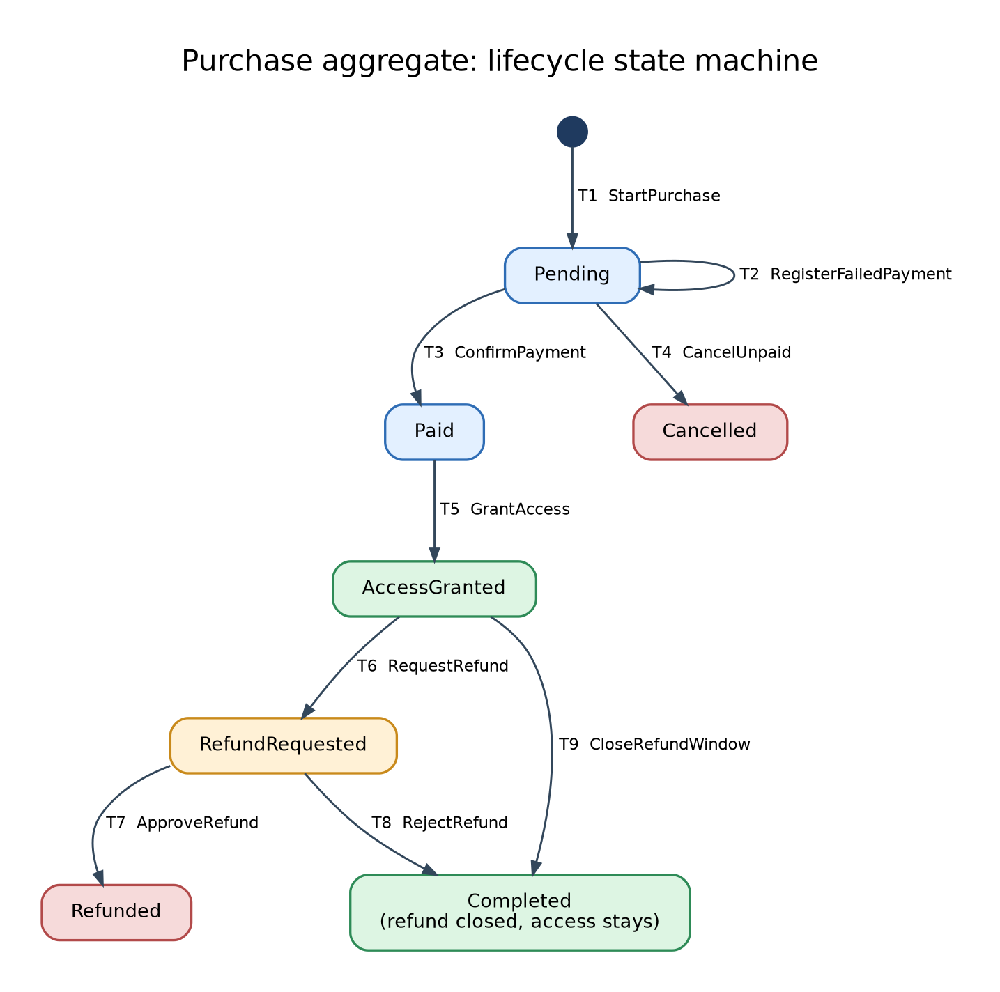

# Purchase: State Machine, Business Invariants and Domain Patterns

**Project:** BundleIt (working name), a worldwide one-time-purchase platform for themed bundles of digital items.
**Main aggregate:** `Purchase`, the pivotal aggregate of the Event Storming board: its events *Started purchase*, *Paid for bundle* and *Granted permanent access* are the thick-bordered events. Every refund, cancellation and payment-expiry rule attaches to it.
**Logic source:** the project's BPMN model of the purchase process (buyer pool and system pool). Section 1 maps each BPMN element to the state machine.
**Related document:** [`aggregates-and-invariants.md`](./aggregates-and-invariants.md) (Value Objects and strongly typed identifiers).

How a purchase begins: the buyer fills a **Cart** (up to 25 items in total) and checks it out. Checkout creates **one `Purchase` per cart line** and one payment for the whole cart. From then on each purchase has its own life cycle, so refunding one bundle never affects another.

## 1. State machine

| State | Meaning |
|---|---|
| `Pending` | Buyer started the purchase and has a payment deadline (default 1 h). Nothing is unlocked yet. |
| `Paid` | Payment confirmed. This is a short transitional state before the automatic access policy runs. |
| `AccessGranted` | Buyer has view access and (if licensed) a download license. This is the long-lived state. |
| `RefundRequested` | Buyer asked for a refund inside the refund window. Waiting for the decision. |
| `Refunded` | Money returned and view access removed. Terminal state. |
| `Cancelled` | Unpaid purchase cancelled or expired. Terminal state. |

Forbidden operations shown in the diagram: `GrantAccess` / `Download` in `Pending`, direct `Cancel` in `AccessGranted`, a second `RequestRefund` in `RefundRequested`, and `ConfirmPayment` in `Cancelled` / `Refunded`.

Instead of boolean flags (`IsPaid`, `IsRefunded`, `IsCancelled`...), the aggregate has one `PurchaseStatus` enum. At any moment the purchase is in exactly one of the six legal states.
The refund decision from the BPMN, drawn as a flowchart:


## 2. Lifecycle state machine of `Purchase`


*(Vector version: [`stateDiagram-purchase.svg`](./stateDiagram-purchase.svg). Editable source: [`stateDiagram-purchase.dot`](./stateDiagram-purchase.dot), rendered with Graphviz.)*

| State | Meaning |
|---|---|
| `Pending` | Purchase started, payment deadline running (default 1 h). Nothing is unlocked. |
| `Paid` | Payment confirmed. Short transitional state before the automatic access grant. |
| `AccessGranted` | Buyer has view access, and a download license if the purchase is Commercial. The refund window (14 days) is open. |
| `RefundRequested` | Buyer asked for a refund. The eligibility policy decides immediately. |
| `Refunded` | Money returned and access removed. Terminal. |
| `Cancelled` | Unpaid purchase cancelled or expired. Terminal. |
| `Completed` | Refund no longer possible (rejected, or the window elapsed). Access stays permanently. Terminal for the purchase. |

### Transitions

| ID | From | To | Command | Condition (guard) | Event raised | Exception when the rule is broken |
|---|---|---|---|---|---|---|
| T1 | (start) | `Pending` | `StartPurchase` | Bundle is published and offers this license type, quantity is valid, a Commercial purchase has valid `BillingDetails` | `PurchaseStarted` | `BusinessBuyerTaxIdRequiredException`, `InvalidQuantityException` |
| T2 | `Pending` | `Pending` | `RegisterFailedPayment` | Payment failed and fewer than 3 attempts were made, so the buyer may retry | `PaymentAttemptFailed` | none (the 3rd failed attempt triggers T4) |
| T3 | `Pending` | `Paid` | `ConfirmPayment` | Before the deadline, and the amount equals the price snapshot | `PurchasePaid` | `PaymentDeadlineExceededException`, `PaymentAmountMismatchException`, `PurchaseNotPayableException` |
| T4 | `Pending` | `Cancelled` | `CancelUnpaid` | The buyer cancels, the deadline expired, or the 3rd payment attempt failed | `PurchaseCancelled` | `PaidPurchaseCancellationException` (when called on a paid purchase) |
| T5 | `Paid` | `AccessGranted` | `GrantAccess` | Automatic after T3. The buyer receives access | `AccessGranted` | `PurchaseNotPaidException` (when called in `Pending`) |
| T6 | `AccessGranted` | `RefundRequested` | `RequestRefund` | Within 14 days after access was granted, and no refund request is open | `RefundRequested` | `RefundWindowClosedException`, `RefundAlreadyRequestedException` |
| T7 | `RefundRequested` | `Refunded` | `ApproveRefund` | The bundle is **unused** according to the refund policy (section 1.3) | `RefundApproved` | `RefundNotEligibleException` |
| T8 | `RefundRequested` | `Completed` | `RejectRefund` | The bundle is **used** according to the refund policy. The buyer keeps access | `RefundRejected` | `RefundRejectionNotAllowedException` (when the bundle is actually eligible) |
| T9 | `AccessGranted` | `Completed` | `CloseRefundWindow` | 14 days passed without a refund request (automatic) | `RefundWindowClosed` | none |

Normal paths:
- **Successful purchase:** T1, T3, T5, then T9 (or T6 followed by T7 / T8).
- **Failed payment:** T1, T2 (repeated), then T4.
- **Refund:** T6, then T7 if the bundle is unused, or T8 if it was used.

### Refund eligibility policy

When a refund is requested, the policy is chosen by the **license type** of the purchase (Strategy pattern, section 4). It looks at what the buyer did with the bundle:

| License type | What the buyer can do | Refund question | Policy | Eligible only if | If eligible | If not eligible |
|---|---|---|---|---|---|---|
| **Personal use** | View only | Were the bundle files ever opened? | `PersonalRefundPolicy` | `ViewCount == 0` | T7 `ApproveRefund` to `Refunded` | T8 `RejectRefund` to `Completed` |
| **Commercial** | View and download | Was the bundle downloaded? | `CommercialRefundPolicy` | `DownloadCount == 0` | T7 `ApproveRefund` to `Refunded` | T8 `RejectRefund` to `Completed` |

For a Commercial purchase only downloads count, so viewing alone does not block a refund.

## 3. Catalog of business invariants

These are domain rules that need the aggregate's current state. Format checks (for example "the bundle title must not be empty") are plain validation at the API boundary and are **not** in this table.

| # | Aggregate | Business rule (invariant) | Domain exception |
|---|---|---|---|
| 1 | `Purchase` | A payment can be confirmed only if the paid amount equals the `PriceSnapshot` (unit price x quantity) in the same currency. | `PaymentAmountMismatchException` |
| 2 | `Purchase` | A payment can be confirmed only before the `PaymentDeadline` has expired. | `PaymentDeadlineExceededException` |
| 3 | `Purchase` | A payment can be confirmed only while the purchase is `Pending` (not `Cancelled` or `Refunded`). | `PurchaseNotPayableException` |
| 4 | `Purchase` | A **Commercial** purchase can be started only with valid `BillingDetails` (company name, address and a `TaxId` of the same country). | `BusinessBuyerTaxIdRequiredException` |
| 5 | `Purchase` | A paid purchase (`AccessGranted`) cannot be cancelled directly. Only the refund process can end it. | `PaidPurchaseCancellationException` |
| 6 | `Purchase` | A refund can be requested only within 14 days after access was granted, and only one request can be open at a time. | `RefundWindowClosedException`, `RefundAlreadyRequestedException` |
| 7 | `Purchase` | A refund is approved only if the bundle is **unused**, judged by license type: **Personal use** = the files were never opened, **Commercial** = the files were never downloaded. | `RefundNotEligibleException` |
| 8 | `AccessRight` | A file can be downloaded only under a **Commercial** license. A Personal-use purchase is view-only. | `DownloadLicenseRequiredException` |
| 9 | `AccessRight` | Access granted by a purchase can be revoked only when that purchase is `Refunded`. Otherwise access is permanent. | `AccessRevocationNotAllowedException` |
| 10 | `Bundle` | An archived bundle accepts no new items. | `BundleArchivedException` |
| 11 | `Bundle` | A bundle can be published only if it contains at least one item. | `EmptyBundleException` |
| 12 | `Bundle` | The Commercial price, if offered, must be at least the Personal price and in the same currency. | `InvalidBundlePricingException` |
| 13 | `Cart` | The total quantity across all lines cannot exceed **25 items**. | `CartLimitExceededException` |
| 14 | `Cart` | A Personal-use line always has quantity 1. A bundle with the same license type appears in at most one line (adding it again sums the quantities). | `InvalidQuantityException` |
| 15 | `Cart` | All lines of a cart use the same currency. | `CartCurrencyMismatchException` |
| 16 | `Cart` | A checked-out cart cannot be changed, and an empty cart cannot be checked out. | `CartAlreadyCheckedOutException`, `EmptyCartException` |
| 17 | `Payout` | A payout cannot exceed the artist's available balance (net sales minus refunds minus earlier payouts). | `InsufficientPayoutBalanceException` |

Notes on rules that need data from another aggregate:

- **Rule 7** needs usage data, which lives in the separate `UsageRecord` aggregate. The application service reads a small `UsageSummary` value and passes it into `ApproveRefund(...)`. The aggregate stays the guardian of the rule without owning the usage data (Vernon's rules 3 and 4).
- **Rule 9:** when a refund is approved, `Purchase` raises `RefundApproved`. A policy then removes the access in `AccessRight` in a separate transaction (eventual consistency). Without a refund, nothing may revoke it.
- **Rules 4, 13-16:** checkout creates one `Purchase` per line. The payment is one transaction at the gateway and its amount is allocated per purchase, so rule 1 is checked against each purchase's own price.

## 4. Given-When-Then scenarios (specification for TDD tests)

### Positive scenarios

| ID | Given | When | Then |
|---|---|---|---|
| P1 | Cart `cart-12` has a Commercial line for bundle `bun-77` with quantity 2. | `AddLine(bun-77, Commercial, quantity 3)` | The cart still has exactly 1 line for `bun-77`, its quantity is 5, and the cart holds 5 items. |
| P2 | Purchase `pur-501` is `Pending`, price snapshot 80.00 EUR, deadline in 20 minutes. | `ConfirmPayment(pay-9, 80.00 EUR, now)` | Status is `Paid`, the payment id is stored, and `PurchasePaid` is raised. |
| P3 | Purchase `pur-502` is `RefundRequested`, license **Personal use**, and its `UsageSummary` shows **0 views**. | `ApproveRefund(PersonalRefundPolicy, usage)` | Status is `Refunded` and `RefundApproved` is raised. |
| P4 | Purchase `pur-503` is `RefundRequested`, license **Commercial**, usage shows **7 views and 0 downloads**. | `ApproveRefund(CommercialRefundPolicy, usage)` | Status is `Refunded`. For a Commercial purchase only downloads count, so viewing alone does not block the refund. |

### Negative scenarios

| ID | Given | When | Then |
|---|---|---|---|
| N1 | Cart `cart-13` holds 24 items. | `AddLine(bun-80, Personal, quantity 2)` | `CartLimitExceededException`. The cart still holds 24 items. |
| N2 | Purchase `pur-504` is `AccessGranted`. | `Cancel()` | `PaidPurchaseCancellationException`. Status stays `AccessGranted`. |
| N3 | Purchase `pur-505` is `Pending` and its deadline expired 5 minutes ago. | `ConfirmPayment(pay-10, 80.00 EUR, now)` | `PaymentDeadlineExceededException`. Status stays `Pending` (the cancel policy closes it). |
| N4 | Purchase `pur-506` is `RefundRequested`, license **Personal use**, usage shows **3 views**. | `ApproveRefund(PersonalRefundPolicy, usage)` | `RefundNotEligibleException`. The application service then calls `RejectRefund`, and the status becomes `Completed`. |
| N5 | Purchase `pur-507` is `RefundRequested`, license **Commercial**, usage shows **1 download**. | `ApproveRefund(CommercialRefundPolicy, usage)` | `RefundNotEligibleException`. Status stays `RefundRequested` until `RejectRefund` is applied. |
| N6 | The `AccessRight` of Personal-use purchase `pur-508`. | `Download(item-3)` | `DownloadLicenseRequiredException`. No download is recorded in the `UsageRecord`. |

## 5. Design patterns applied in the domain

| GoF pattern | Where it is used | Purpose |
|---|---|---|
| **Strategy / Domain Policy** | `IRefundEligibilityPolicy` with `PersonalRefundPolicy` and `CommercialRefundPolicy` (the BPMN gateway "Type of the bundle being purchased?"); `ITaxIdFormatRule` per country | The refund rule differs per license type, and tax id formats differ per country. A new license type or country is a new class, and existing classes stay untouched (Open/Closed Principle). |
| **Factory Method** | `Purchase.Start(...)`, `Cart.CreateEmpty(...)` | The constructor is private. A purchase can only be created in a valid state (`Pending`, with price snapshot and deadline). |
| **State** (explicit transition guard) | `PurchaseStatus` enum with checks in each method | Only the legal transitions of section 2 are possible. |

The policy only answers "is this bundle unused?". The `Purchase` aggregate still has the final say: it checks its own state, the refund window, and that approving is allowed.

```csharp
namespace BundleIt.Purchasing.Domain;

public enum LicenseType { Personal = 1, Commercial = 2 }

// Strategy / Domain Policy
public interface IRefundEligibilityPolicy
{
    LicenseType AppliesTo { get; }
    bool IsEligible(UsageSummary usage);
}

public sealed class PersonalRefundPolicy : IRefundEligibilityPolicy
{
    public LicenseType AppliesTo => LicenseType.Personal;
    public bool IsEligible(UsageSummary usage) => !usage.WasOpened;        // "ever opened?"
}

public sealed class CommercialRefundPolicy : IRefundEligibilityPolicy
{
    public LicenseType AppliesTo => LicenseType.Commercial;
    public bool IsEligible(UsageSummary usage) => !usage.WasDownloaded;    // "downloaded?"
}

public class Purchase
{
    private static readonly TimeSpan RefundWindow = TimeSpan.FromDays(14);

    public PurchaseId Id { get; private set; }
    public BuyerId BuyerId { get; private set; }
    public BundleId BundleId { get; private set; }
    public LicenseType License { get; private set; }
    public Quantity Quantity { get; private set; } = default!;
    public Money PriceSnapshot { get; private set; } = default!;
    public PaymentDeadline Deadline { get; private set; } = default!;
    public DateTimeOffset? AccessGrantedAt { get; private set; }
    public PurchaseStatus Status { get; private set; }

    private Purchase() { }   // hidden constructor (e.g. for EF Core)

    // Factory Method
    public static Purchase Start(
        BuyerId buyerId, BundleId bundleId, LicenseType license, Quantity quantity,
        Money unitPrice, BillingDetails? billing, DateTimeOffset now)
    {
        if (license == LicenseType.Personal && quantity.Value != 1)
            throw new InvalidQuantityException(quantity.Value);

        if (license == LicenseType.Commercial && billing is null)
            throw new BusinessBuyerTaxIdRequiredException(buyerId);

        return new Purchase
        {
            Id = PurchaseId.New(),
            BuyerId = buyerId,
            BundleId = bundleId,
            License = license,
            Quantity = quantity,
            PriceSnapshot = unitPrice.Multiply(quantity.Value),
            Deadline = PaymentDeadline.Of(now, TimeSpan.FromHours(1)),
            Status = PurchaseStatus.Pending
        };
    }

    public void ConfirmPayment(PaymentId paymentId, Money paid, DateTimeOffset now)
    {
        if (Status != PurchaseStatus.Pending)
            throw new PurchaseNotPayableException(Id, Status);
        if (Deadline.IsExpiredAt(now))
            throw new PaymentDeadlineExceededException(Id);
        if (paid != PriceSnapshot)
            throw new PaymentAmountMismatchException(PriceSnapshot, paid);

        Status = PurchaseStatus.Paid;
        // raise domain event: PurchasePaid(Id, paymentId)
    }

    public void Cancel()
    {
        if (Status != PurchaseStatus.Pending)
            throw new PaidPurchaseCancellationException(Id);

        Status = PurchaseStatus.Cancelled;
    }

    public void RequestRefund(DateTimeOffset now)
    {
        if (Status == PurchaseStatus.RefundRequested)
            throw new RefundAlreadyRequestedException(Id);
        if (Status != PurchaseStatus.AccessGranted || now > AccessGrantedAt!.Value + RefundWindow)
            throw new RefundWindowClosedException(Id);

        Status = PurchaseStatus.RefundRequested;
    }

    public void ApproveRefund(IRefundEligibilityPolicy policy, UsageSummary usage)
    {
        if (Status != PurchaseStatus.RefundRequested)
            throw new InvalidPurchaseTransitionException(Id, Status);
        if (!policy.IsEligible(usage))
            throw new RefundNotEligibleException(Id, License);

        Status = PurchaseStatus.Refunded;
        // raise domain event: RefundApproved(Id)  -> policy removes access in AccessRight
    }

    public void RejectRefund(IRefundEligibilityPolicy policy, UsageSummary usage)
    {
        if (Status != PurchaseStatus.RefundRequested)
            throw new InvalidPurchaseTransitionException(Id, Status);
        if (policy.IsEligible(usage))
            throw new RefundRejectionNotAllowedException(Id);

        Status = PurchaseStatus.Completed;   // access stays
    }
}
```

<details>
<summary>Diagram source (Graphviz DOT) for the state machine</summary>



Render with: `dot -Tpng -Gdpi=130 stateDiagram-purchase.dot -o stateDiagram-purchase.png`

</details>
